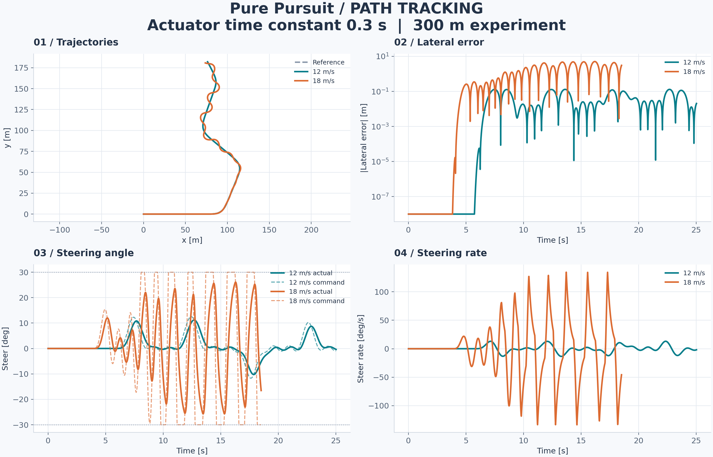
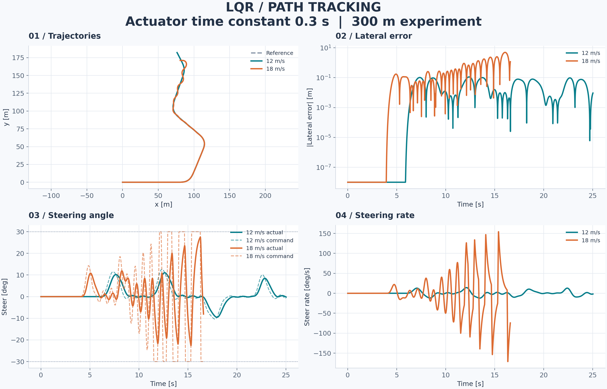

# mini-autonomous-driving-project

# Path Tracking with Steering Actuator Lag

A small simulation comparing Pure Pursuit and LQR on a nonlinear 
kinematic bicycle model. The experiment explores how controllers 
tuned at one speed behave when speed increases while steering 
actuator has 0.3 s lag.

## Model and setup

- 300 m reference path with four smooth turns
- Constant vehicle speed; wheelbase: 2.5 m
- First-order steering actuator: τ = 0.3 s
- Steering command limited to ±30°
- Simulation step: 0.01 s
- Zero initial position and heading errors; no measurement noise

The steering actuator follows:

δ̇ = (δ_command − δ) / τ

Tracking is declared lost when the lateral error exceeds 1 m or the 
heading error exceeds 60° continuously for 1 s. Brief violations do 
not stop the simulation.

## Parameter selection

Both controllers are tuned at 12 m/s, using the same objective:
minimum RMS lateral error among runs that complete the route.

| Controller | Search grid | Selected setting |
|---|---|---|
| Pure Pursuit | 15 lookahead distances from 3 to 12 m | Lookahead ≈ 3.64 m |
| LQR | q_y/r ∈ {0.03, 0.1, 0.3, 1, 3};   q_ψ/r ∈ {0.3, 1, 3} | q_y/r = 0.3,  q_ψ/r = 3 |

The selected parameters are then held fixed as speed increases.
The LQR design uses a linearized error model without actuator dynamics.

## Results

At 12 m/s, both selected controllers complete the route with small errors.

| Controller | RMS lateral error | Maximum lateral error |
|---|---:|---:|
| Pure Pursuit | 0.054 m | 0.129 m |
| LQR | 0.044 m | 0.112 m |

At 18 m/s the tracking quality drops a lot:

| Controller | Outcome | Maximum lateral error | Command saturation |
|---|---|---:|---:|
| Pure Pursuit | Completes 300 m; RMS error ≈ 2.00 m | 5.00 m | 35.7% |
| LQR | Loses tracking at 288 m | 4.93 m | 24.1% |

### Pure Pursuit

### LQR

## What this demonstrates

Good tracking at the tuning speed does not mean the controller will 
still work well at a higher speed. Choosing parameters only by lateral
RMS can give a controller that is accurate at the design point but 
sensitive to speed changes.

Even though the actuator time constant stays the same, the vehicle 
travels farther during the actuator response when speed is higher.  
Steering lag should therefore be taken into account when tuning and 
testing a path-tracking controller.

These results support that point, but they do not prove that lag is the
only reason for the drop in performance. A full check would need tests 
with different actuator time constants. This single-road experiment only 
shows sensitivity to speed and tuning. 
## Run

pip install -r requirements.txt 
python tuning.py 
python main.py 

tuning.py searches the parameter grid and prints the settings selected
at 12 m/s. main.py runs the configured comparison and saves figures and metrics
to results.
